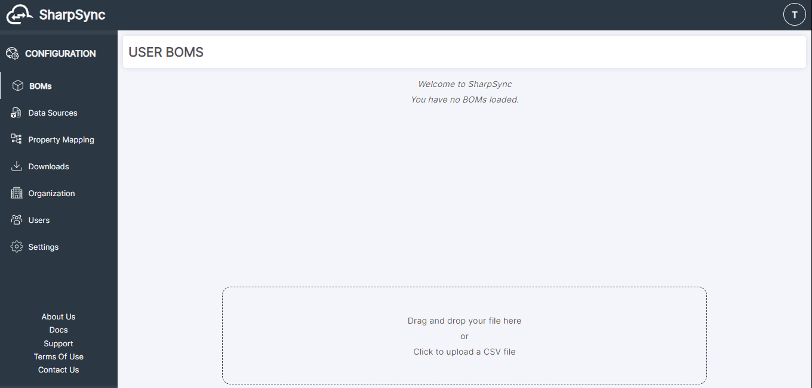
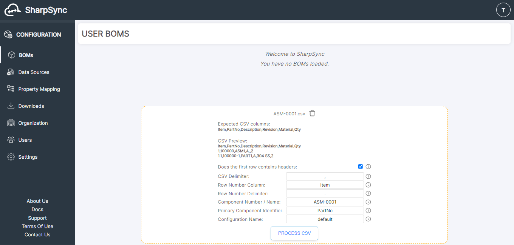
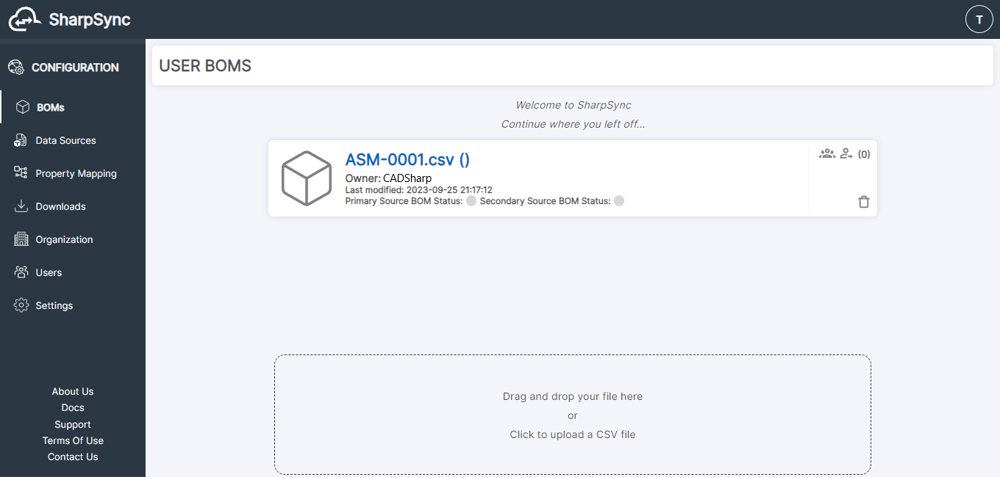
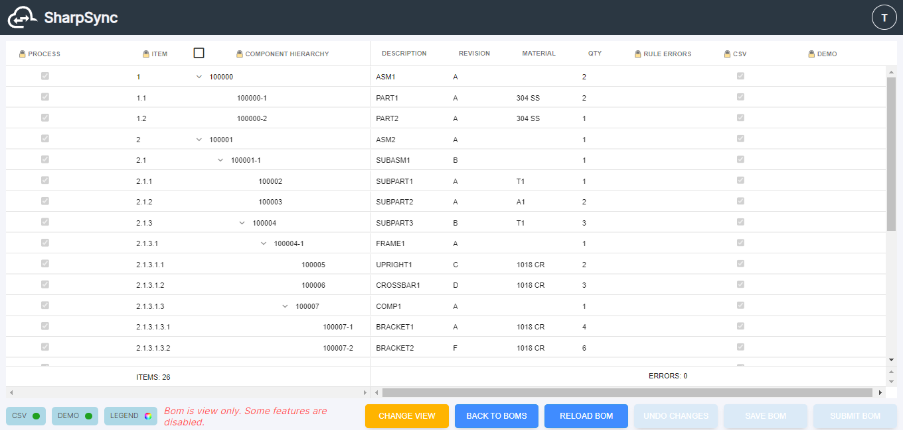

# Importing a Bill of Materials (BOM)

## Importing a CSV BOM

Once the Data Sources and Property Mappings have been set up (see section [Property Mappings](../../fundamentals/property-mappings/)), you can now begin importing CSV Bills of Materials.

#### Get the CSV BOM

<figure><figcaption><p>A londing page  where CSV files may be dropped or selected</p></figcaption></figure>

\
On the SharpSync BOMs page, click **UPLOAD CSV BOM** at the bottom of the page. Drag and drop your .csv file into the dialog from a File Manager (Explorer for Windows, Finder for Mac), or click inside the box and navigate to where the file is located.

#### Pre-Process Specifications

<figure><figcaption><p>Edit the file settings before importing</p></figcaption></figure>


The dialog shows the file's name, the **Expected CSV columns** (the Primary Data Source Property of each enabled property mapping) and the first lines of the file. Check the settings below, then upload.

1. _The first row must contain headers._ SharpSync always reads the first line of the file as the column names.
2. _CSV Delimiter._ Typically, a CSV file will separate each "cell" with a common delimiter, typically a comma. Enter the delimiter used.
3. _Row Number Column._ Type in the name of the column that contains the Row Numbers. This is important as these numbers are what is used to establish the assembly hierarchy. Every cell in this column should have a different Row Number.
4. _Row Number Delimiter._ Enter the row number delimiter. SharpSync parses the hiearchy for each item using its row number.
   * Row Numbers with a Period: 1.2.3.4
   * Row Numbers with a Comma: 1,2,3,4
5. _Component Name Column._ Type in the name of the column that identifies each component, usually the part number. It starts as your data source's Primary Identifier. The BOM is named after this column's value on the top-level row.
6. _Configuration Column._ Optional: the name of the column that contains each component's configuration. Leave it empty if the file has none.
7. _Version Column._ Optional: the name of the column that contains each component's version. Leave it empty if the file has none.
8. Click **UPLOAD** to finish. The BOM page will show the newly added BOM.

Column names must match the file's header row exactly, capital letters and spaces included. If the dialog can't find the Row Number Column, the Component Name Column, or a top-level row with a value in the Component Name Column, it doesn't upload the file and shows `CSV Processing Error - Unable to determine unique component number from the CSV`. Check both column names against the header row, and check that the file has a top-level row (see below).

<figure><figcaption><p>The Bill of Materials is displayed after import</p></figcaption></figure>


#### Import Success

The BOM is now ready to be accessed once it is uploaded. Click on the BOM to view its contents.

<figure><figcaption><p>The Bill of Materials detail is displayed when selected</p></figcaption></figure>

#### When the BOM isn't saved

Before it saves the BOM, SharpSync checks the file's structure. If it finds a problem, it saves nothing and shows a red alert listing every problem, one per line. Each problem names the row by its row number. Hover over the alert to keep it open.

```
Status Code: 400
Could not add file lookup to the server
The BOM was not saved. 3 problems:
• Row 1.2.1: no parent row 1.2
• Row 1.2.1: quantity is empty
• Rows 1.1 and 1.4 are the same component (BOLT-5); combine them into one row
```

The refused file isn't kept. Fix the file, then upload it again. Nothing was saved, so there is nothing to clean up first.

A file is saved when:

* It has exactly one top-level row: a row number with no row number delimiter, such as `1`. Every other row sits under it (`1.1`, `1.2`, `1.2.1`).
* Every line has a row number, no row number is used twice, and every row's parent row is in the file: row `1.2.1` needs a row `1.2`.
* Every row has a value in the Component Name Column, with no space at the start or end. SharpSync never trims these values.
* A component appears only once under the same parent. If the file lists it twice, combine the lines into one and add up the quantities.
* No row has the same value as a row it sits under, since an assembly can't contain itself.
* No two values in the Component Name Column differ only in capitalization, such as `BOLT-5` and `bolt-5`, anywhere in the file.
* Every row has a quantity. The quantity column is the one named after your quantity mapping's Primary Data Source Property, and it is listed in **Expected CSV columns**. Only an empty quantity is refused: `1,5` or `2 pcs` is saved as it is, and your [rules](../../fundamentals/rules/) decide which quantities are valid.

[BOM not saved](../../fundamentals/troubleshooting/bom-not-saved.md) explains each message and how to fix it.

<br>
