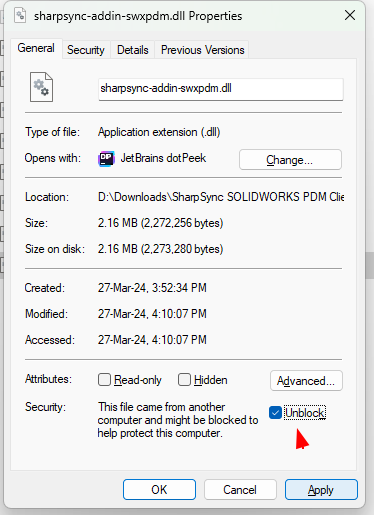
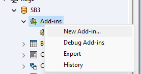
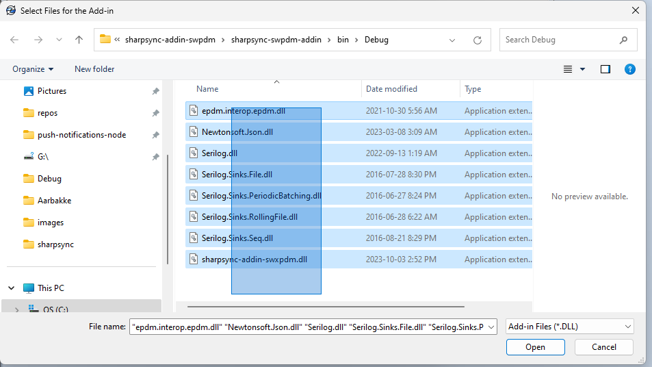

# Downloading and installing the add-in

SolidWorks PDM is a data management solution from Dassault Systémes. It allows you to manage SolidWorks files and their revisions, along with metadata like Vendor, Material, Description, etc.

### Prerequisites

* PDM Professional 2024 or later must be used. The add-in is built for PDM 2024 and also runs on every later version
* The PDM Professional version API must be exposed to the internet using the Web API setup guide
* We do support bi-directional sync on request, but this is disabled by default to prevent updates to already approved data

### Downloading the add-in

The download for the PDM client may be found at [https://app.sharpsync.net/admin/downloads](https://app.sharpsync.net/admin/downloads)


The PDM Client is only available for Windows machines. It is not available for Mac or Linux.


* Login on SharpSync
* Navigate to the Downloads section
* Download the **SharpSync SOLIDWORKS PDM Client**. Its name ends with the add-in's version (for example `v202601041`), and the same download is for every PDM version from 2024 on

<figure><figcaption></figcaption></figure>

### Installing the add-in


By default Windows will block all `.dll` and `.exe` files downloaded from an internet source. Because of this the add-in will fail to install. You first need to unblock it.


#### Unblocking the zip file

Unblock the zip file before you extract it. Windows then extracts every file in it unblocked, so you don't have to unblock them one by one.

* Right click the downloaded zip file > `Properties`
* At the bottom of the first tab, there is a security warning
* Select the checkbox reading `Unblock`
* Click the apply button

<figure><figcaption>
The Unblock checkbox, shown here on one of the add-in's files
</figcaption></figure>

Failing to do so may result in the following message when installing a PDM add-in:

> "The archive server could not open the Windows Registry",

#### Extracting the files

Extract the files to a convenient location (e.g. Desktop) using `Right click > Extract all...`.

If you extracted the files before unblocking the zip file, delete the extracted folder, unblock the zip file, and extract it again.

#### Adding the add-in to the vault

* Open the administration tool and login on the vault
* Right click Add-ins > New Add-in

<figure><figcaption></figcaption></figure>

* Select the SharpSync add-in from the extracted files. Make sure to _select_ _all_ the files

<figure><figcaption></figcaption></figure>

* Click Open

#### If you see no other error messages, the add-in is considered installed

Here are some other steps in case installation still fails.

There are several things that can cause this error but these are the fixes that resolved this issue 100% of the time:

* Right click each `*.dll`file, go to Properties, and check 'Unblock' in the lower right hand corner. This works most of the time (example above).
* If that doesn't work, or your company's policy doesn't let you unblock files (the `Unblock` checkbox is missing), install the add-in from an Admin Export (`*.cex`) file instead: export the add-in as a `*.cex` from a system where it installed, or ask SharpSync support for one, and import it on the end user's system. Bear in mind that this may cause other issues though, so only use it as a last resort.
* It can also happen when the .net framework that the add-in is written against does not exist on the machine where the -is being installed

### Updating the add-in

If you need to update your add-in to a newer version, you'll need to replace the files in your current add-in with the files from a newly-downloaded version:

* Download the newer version of the add-in from SharpSync, then unblock and extract it as described above
* Open the SWPDM Administration tool and select the currently-installed add-in
* In the Files tab of the currently-installed add-in, select Add Files

<figure><figcaption></figcaption></figure>

* Add the newly-downloaded files to the add-in. SolidWorks PDM will replace all of the outdated files with the newer ones.
* Click OK


Any client machines will need to be restarted before they can use the newer version of the add-in.


#### Delete the old log files

If the add-in you're updating is older than version **202601041**, delete its log files once after updating. Older versions wrote the add-in's settings to its log every time they were saved in **Configure SharpSync**, including the SQL password and SharpSync sign-in tokens. Version 202601041 and later don't, but they keep writing to the same files, so the old entries stay until you delete them.

On each computer that has the add-in, for each Windows user who uses it:

* Restart the computer (the update needs this anyway), and do the next steps before you open the vault in File Explorer
* Press `Windows + R`, enter `%LOCALAPPDATA%\CADSharp LLC\SharpSync PDM Addin` and click **OK**
* Delete `log-debug.log` and `log-error.log`. The add-in creates new ones the next time it runs


If you've sent these log files to anyone, including SharpSync support, change the password of every SQL account entered on the **SQL Configuration** tab of Configure SharpSync, including the setup account, and enter the new password there.

