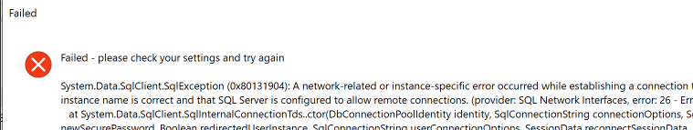

# Troubleshooting

## **Issue: Testing a connection to SQL fails**

When testing your connection to your SQL server, the SharpSync add-in tries to connect to the server using the specified credentials.

To connect to just use {serverName}&#x20;


If your instance of SQL is the default instance but there are more than 1 instances on the box, use the scheme {serverName}\MSSQL


In the setup, on the SQL Config Tab, when clicking `Test Connectivity` you may receive this error message:

<figure><figcaption>
Connection to SQL server failed
</figcaption></figure>

If that is the case, try adding / removing the instance name

## **Issue: Add-in fails to extract or register on load**

It is possible that when the SharpSync add-in is installed with insufficient permissions, that the installation fails.

The way SolidWorks PDM add-ins are distributed in a vault are:

* The client view starts up (viewserver.exe)
* It checks the database for add-in versions
* If the installed versions of the add-in does not match, it copies a new version of the addin to the local machine.
* The new version is copied to&#x20;

> %localAppData%\SolidWorks\SOLIDWORKS PDM\Plugins\\{vaultName}\\{CLSID}{version}

<figure><figcaption></figcaption></figure>

* The addin is then registered.
* During activation (logging into the vault), the registration process can fail if insufficient permissions are available or the registration process is interrupted.

Any subsequent activation of the add-in may fail with the below error

> Failed to extract add-in from&#x20;
>
> %localAppData%\SolidWorks\SOLIDWORKS PDM\Plugins\\{vaultName}\\{CLSID}{version}
>
> Class not registered.

<figure><figcaption></figcaption></figure>

#### The fix

Should this happen, do the following

* Log out of the vault on the machine
* Run Registry Editor as administrator (regedit.exe)
* Find the key in the HKCR\CLSID folder for the broken add in here&#x20;

> Computer\HKEY\_CLASSES\_ROOT\CLSID\\{4B1265A4-C784-4CC5-991F-2AD1442538F3}

* Delete the key

<figure><figcaption></figcaption></figure>

* Sometimes you might have to restart the machine, but simply logging back in to the vault should complete the registration process.

## **Issue: Send BOM shows an error and the BOM isn't saved**

After **SharpSync > Send BOM...**, an error dialog appears and the BOM doesn't appear on the SharpSync BOMs page. SharpSync checked the BOM's structure, found a problem and saved nothing.

The dialog also shows technical detail. Look for the line starting `The BOM was not saved`: the problems follow it, separated by `\n`.

#### The fix

Fix the problems in the files, then Send BOM again. [BOM not saved](../../fundamentals/troubleshooting/bom-not-saved.md) explains each message and how to fix it.

## **Issue: Every row says quantity is empty**

Send BOM is refused with `quantity is empty` on every row, although the PDM BOM shows the quantities.

This can happen when two property mappings have **Is Quantity Property** checked and one of them is disabled. The add-in can write the quantity under the disabled mapping's Primary Data Source Property, where SharpSync doesn't look for it.

#### The fix

On the Property Mappings page, delete the disabled mapping that has **Is Quantity Property** checked in its [settings](../../fundamentals/property-mappings/property-mapping-settings.md). Then Send BOM again.

## **Issue: Quantities show a decimal comma, such as 1,5**

On a machine set to use a decimal comma, the add-in sends quantities as PDM shows them, such as `1,5`. SharpSync saves them as they are.

#### The fix

Add an import rule that replaces `,` with `.`. See [Quantities SharpSync accepts](../../fundamentals/troubleshooting/bom-not-saved.md#quantities-sharpsync-accepts).

## **Issue: A part no longer reaches the ERP as an assembly**

A part whose only references in the PDM BOM are [excluded file types](configure-the-add-in.md), such as its PDF or STEP files, used to be sent as an assembly with no components. SharpSync now works out which rows are assemblies from the BOM itself, so this part arrives as a part and reaches your ERP as a part.

This is expected, and there is nothing to fix.
