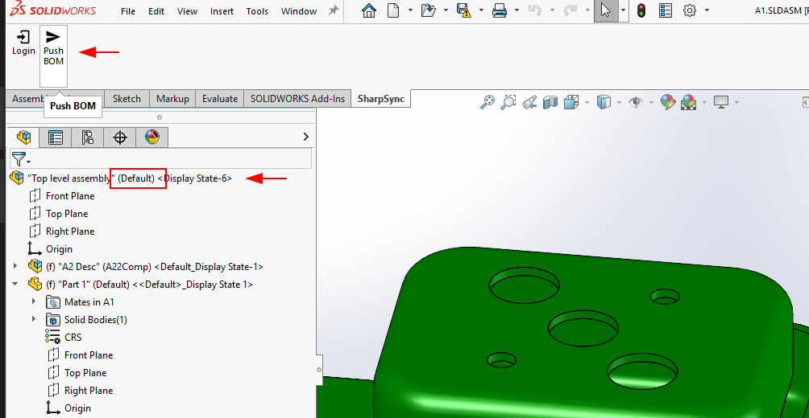
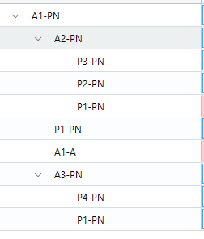

# SolidWorks

### Bill of Material (BOM) level features

<table><thead><tr><th width="335.0078125">Feature</th><th width="115.390625" align="center">Read</th><th width="144.890625" align="center">Create</th><th width="113.16796875" align="center">Update</th></tr></thead><tbody><tr><td>BOM hierarchy</td><td align="center"><span data-gb-custom-inline data-tag="emoji" data-code="2705">✅</span></td><td align="center">N/A</td><td align="center">N/A</td></tr><tr><td>BOM meta data **</td><td align="center"><span data-gb-custom-inline data-tag="emoji" data-code="2705">✅</span></td><td align="center">N/A</td><td align="center"><span data-gb-custom-inline data-tag="emoji" data-code="2705">✅</span>**</td></tr><tr><td>BOM quantities</td><td align="center"><span data-gb-custom-inline data-tag="emoji" data-code="2705">✅</span></td><td align="center">N/A</td><td align="center">N/A</td></tr><tr><td>Component thumbnails</td><td align="center"><span data-gb-custom-inline data-tag="emoji" data-code="2705">✅</span></td><td align="center">N/A</td><td align="center">N/A</td></tr><tr><td>BOM Configurations</td><td align="center"><span data-gb-custom-inline data-tag="emoji" data-code="2705">✅</span></td><td align="center">N/A</td><td align="center">N/A</td></tr><tr><td>File derivative transfers (e.g. STEP, DXF)</td><td align="center"><span data-gb-custom-inline data-tag="emoji" data-code="2705">✅</span></td><td align="center">N/A</td><td align="center">N/A</td></tr><tr><td></td><td align="center"></td><td align="center"></td><td align="center"></td></tr></tbody></table>

\*\* 2 way sync updates to BOM metadata are available on request

## SolidWorks Add-in Setup

SolidWorks files (\*.sldasm, \*.sldprt) are utilized to import Bills of Materials (BOMs) from desktop-based CAD software into SharpSync. (Drawing files' BOM's are not currently supported, but if demand is high enough we will consider it) Follow the steps below to begin importing data into SharpSync using CSV files.

* [Prerequisites](solidworks.md#prerequisites)
* [Setup Instructions](solidworks.md#setup-instructions)
* [Push a Bill of Materials to SharpSync](solidworks.md#push-a-bill-of-materials-to-sharpsync)
* [What the BOM includes](solidworks.md#what-the-bom-includes)
* [When the BOM is not sent](solidworks.md#when-the-bom-is-not-sent)

### Prerequisites

* An installation of SOLIDWORKS 2024 or later
* Download the SOLIDWORKS add-in installer from the `Downloads` section in `SharpSync`, close SOLIDWORKS and run the installer. It replaces any older version of the add-in
* An assembly or part file
* Drawings Bill of Materials are not supported yet, but talk to us about integration

### Setup Instructions

#### Setup the CSV datasource in SharpSync

* From the [`Data sources` ](../fundamentals/data-sources.md#core-concept-sources) section, add the CSV Data Source as the Primary Data Source
* Click the `Configure` button > `BOM Configuration`
* On a new line each, enter the Custom Properties to read
* These properties should be the standard properties that exist in any given SolidWorks file. If it does not exist, a blank value will be used
* Properties are read from the `Configuration` tab first, then the `Custom` tab. A property that exists on the `Configuration` tab is used even when it's empty
* Each value entered here will be available as an `Accessor` (Property) in the `Property Mappings` tab
* Make sure to add the Quantity / Qty / qty. column (this will be used later in the property mappings). (The exact naming is not important, as long as it reflects the quantity of parts in an assembly)

> For example if you want to display custom properties `Number`, `Description`, `Material`, then enter these on a new line each

* Click the `Save` button
* On the main Data Source tab, make sure that the `Primary Component Identifier` matches with your `Number` custom property.

The primary component identifier is the identifier that is unique across data source domains. If this is `Number` or `No` or `PartNumber` then the assumption is this property exists in both SolidWorks and your ERP solution.


&#x20;It does not have to be called `Number`. It can be called anything as long as it exists as a SolidWorks custom property. A file with no value in this property stops the push: see [When the BOM is not sent](solidworks.md#when-the-bom-is-not-sent)


In the example below I've setup

* Number
* Description
* Revision
* Qty (Settings > Is Quantity property must be enabled)

#### Configure the Add-in

After installing the SOLIDWORKS add-in, log in and check which identifier it will use. Make sure your SOLIDWORKS files have the required properties. (Flattened BOMs are not supported)

* Click Tools > SharpSync > Login
  * The SharpSync login page opens in a window. Log in the same way as on the SharpSync website
  * If successful, the window will close
* Click Tools > SharpSync > Settings
  * The window shows the `Primary Component Identifier` of your CSV Data Source. You can't change it here: change it in the Data Source
  * `VIEW LOGS` opens the folder that holds the add-in's log files

### Push a Bill of Materials to SharpSync

Pushing data from SolidWorks to SharpSync is easy and straight forward. To push a Bill of Materials (BOM) to SharpSync do the following:

* Open a part or assembly file
* Make sure you've logged in to SharpSync (Click the login button at least once)
* Click the Push BOM button
* The active configuration of the assembly is used to display data in SharpSync

<figure><figcaption><p>Click the button to send the Bill of Materials to SharpSync</p></figcaption></figure>

* The configuration for the assembly is loaded in SharpSync.
* The version will always be shown as `current`.
* If you want to use information from different versions, the add-in for `SolidWorks PDM Professional` is recommended.

<figure><figcaption></figcaption></figure>


In the example below, the hierarchy in SharpSync is displayed using the mapped `Number` property mapped in SharpSync.

Notice that the component names are taken from the `Number` primary component identifier

<figure><figcaption></figcaption></figure>


You're now ready to submit this to your ERP.

### What the BOM includes

The BOM follows your SOLIDWORKS settings, so it has the same rows as an indented SOLIDWORKS BOM of the open assembly. Each component is read in the configuration its parent assembly uses.

| In SOLIDWORKS                                    | In SharpSync                                                                                                                     |
| ------------------------------------------------ | -------------------------------------------------------------------------------------------------------------------------------- |
| Suppressed component                             | Left out, with everything under it                                                                                               |
| Component excluded from the BOM                  | Left out, with everything under it                                                                                               |
| Envelope component                               | Left out, with everything under it                                                                                               |
| Sub-assembly with child display set to `Show`    | A row, with its children under it                                                                                                |
| Sub-assembly with child display set to `Hide`    | A row, without its children                                                                                                      |
| Sub-assembly with child display set to `Promote` | No row. Its children move up one level and their quantities multiply: a sub-assembly used twice that holds 4 bolts gives 8 bolts |

Child display is in the sub-assembly's configuration properties, under `Bill of Materials Options` > `Child component display when used as subassembly`. It only applies to a sub-assembly: the assembly you open and push always gets a row with its children.

#### Lightweight assemblies

You can push an assembly opened in Lightweight mode. The add-in first resolves any lightweight components, without asking, because it can't read them otherwise. On a large assembly the push takes longer while the parts load. The components stay resolved afterwards.

An assembly opened in `Large Design Review` can't be pushed. The add-in stops with `Could not read the components of...` and nothing is saved. Open the assembly in Resolved or Lightweight mode and push again.

### When the BOM is not sent

If there's a problem, the add-in shows one `BOM not sent` dialog that lists it, and nothing is saved. Fix the problem in your files, then click the Push BOM button again.

The add-in checks your files first. A list stops at 25 lines, followed by "…and N more". Fix those and push again to see the rest.

**A file has no identifier.** Each file is named with its configuration:

```
These files have no 'Number' value, so the BOM was not sent:
bracket.sldprt (Default)
```

Give each file a value. If a listed file already has one, its configuration has its own empty `Number` property, which is used before the file's. Fill it in or delete it.

**Two files or configurations share an identifier under one parent:**

```
BOLT-5 is used by 2 different files under TOP-100: bolt.sldprt, bolt-copy.sldprt
BOLT-5 is used by 2 configurations of bolt.sldprt under TOP-100: M6x20, M6x30
```

An identifier names one file in one configuration, so give each one its own identifier, or use one file. The same file in the same configuration used several times is fine: it's one row with its count.

**A component can't be read:**

```
Could not read the components of TOP-100.SLDASM. Make sure the assembly is fully loaded, then try again
Could not resolve bolt-1 (C:\Parts\bolt.sldprt), which is loaded lightweight. Set it to resolved in SOLIDWORKS, then try again
Could not read bolt-1 (C:\Parts\bolt.sldprt). Make sure the file can be opened and the assembly is fully loaded, then try again
```

The add-in stops here rather than send a BOM with rows missing. Do what the message says, then push again.

Once these pass, SharpSync checks the BOM's structure. [BOM not saved](../fundamentals/troubleshooting/bom-not-saved.md) explains each of its messages and how to fix it.
