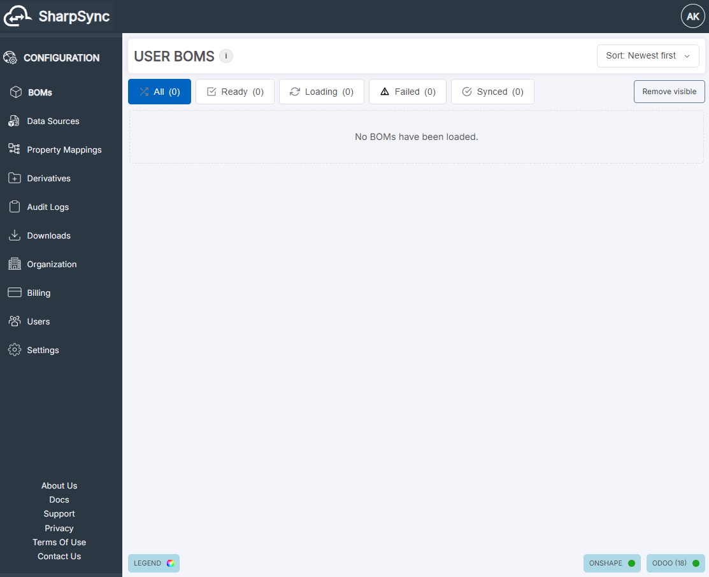

# Landing Page

After logging in, you'll be redirected to the landing page.

<figure><figcaption>
Landing Page with no BOMs visible
</figcaption></figure>

From here you can perform the following actions:

* Edit and delete existing BOMs
* [Add BOM viewers](#adding-bom-viewers)
* Transfer the BOM to another user.
* View BOM submission error reports.


Deleting a BOM in SharpSync does not delete the data at the Data Source, it simply removes the data from SharpSync.


### Adding BOM viewers

1. Expand the BOM's card by clicking the arrow at the bottom of the card.
2. Click the `Viewers` button in the bottom-right corner (it shows the current count, e.g. `0 Viewers`), then choose `Manage viewers`.
3. Tick each person who should see the BOM. Untick someone to remove them.
4. Click `Share`.

Only people already in your organization appear in the list. If someone is missing, an administrator must invite them first. See [User Management](../../user-management/user-management.md).

Viewers can see and transfer the BOM, but cannot edit, delete or submit it. See [Application Permissions](../../user-management/application-permissions.md). A viewer can leave a BOM at any time with `Viewers` → `Remove myself`.

BOM Sets work the same way.
